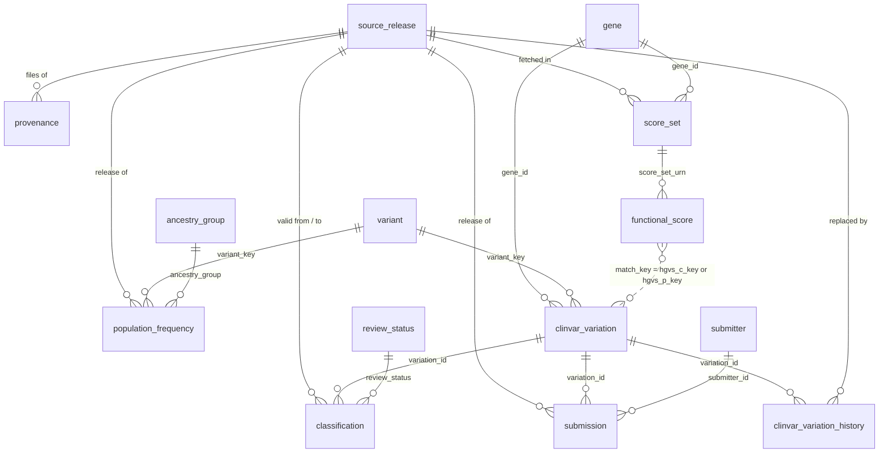

# Entity relationships

Solid lines are foreign keys. On DuckDB the two keys into
`clinvar_variation` from `classification` and `submission` are checked by
`vwh validate` instead (see `migrations/0004_foreign_keys.postgres.sql`).
The dotted line is the MaveDB join, which is a text match, not a key: a
nucleotide score set matches the transcript and c. change with the transcript
version dropped, a protein score set matches gene and p. change.

Keys:

- `variant.variant_key`: GRCh38 `chrom-pos-ref-alt` from ClinVar's
  PositionVCF/ReferenceAlleleVCF/AlternateAlleleVCF and gnomAD's VCF columns.
  ClinVar records without VCF alleles (copy number changes, for example) have
  a `clinvar_variation` row with a null key.
- `clinvar_variation.variation_id`: ClinVar VariationID. `allele_id` is kept
  but is not unique across releases: 65 AlleleIDs moved to a new VariationID
  between 2025-10 and 2026-10.
- `classification`: one row per version of the aggregate record;
  `is_current` rows have a null `valid_to_release_id`.
- `clinvar_variation_history`: the attribute values a release overwrote,
  keyed by VariationID and the release that replaced them (4,212 rows for
  2026-10). `vwh unload` writes them back.
